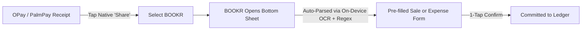

# BOOKR — Product Blueprint & Specifications
*The Ultra-Lightweight Financial Ledger for Student Entrepreneurs*

---

## 1. Executive Summary & Product Manifesto

**The Problem with Existing Apps (Bumpa, QuickBooks, etc.):**
Existing commercial apps suffer from **feature bloat** — they try to be an all-in-one e-commerce website builder, CRM, multi-channel dispatch, marketing machine, and complex accounting engine. For a student running a side hustle or campus micro-venture, this is overwhelming friction.

**The BOOKR Philosophy:**
> *"If you want an online e-commerce website, go use Bumpa. BOOKR exists for one specific job: replacing the messy paper notebook with an effortless, 3-tab financial tracker on your phone."*

BOOKR is 100% focused on recording money in, money out, and stock — fast, offline, and without friction.

---

## 2. The "Rule of 3 Tabs" Architecture

When the student opens BOOKR, there is zero clutter. The app consists of **3 clean tabs**:

```
┌────────────────────────────────────────────────────────┐
│                        BOOKR                           │
│  [ Safe-to-Spend: ₦18,500 ]  [ Hustle Cash: ₦42,000 ]  │
├───────────────────┬───────────────────┬────────────────┤
│    📉 EXPENSES     │     📈 SALES      │   📦 INVENTORY  │
│  (Money Going Out)│ (Money Coming In) │  (What You Have)│
└───────────────────┴───────────────────┴────────────────┘
```

1. **📉 Expenses Tab (Money Going Out):**
   - Clean list of outgoing payments.
   - Quick filters: Personal vs. Hustle (or category tags: Materials, Transport, Food, Tools).
   - Large, immediate `+ Add Expense` button.

2. **📈 Sales Tab (Money Coming In):**
   - Clean list of customer payments, gigs, and sales.
   - Indicates payment status: Received vs. Unpaid/Pending.
   - Fast `+ Record Sale` button.

3. **📦 Inventory Tab (What You Have — TOGGLABLE):**
   - Simple list: Item Name, Quantity in Stock, Cost Price, Selling Price.
   - **Togglable in Settings:** If the user is a service freelancer (graphic designer, tutor, photographer, developer), they can toggle Inventory **OFF**. The 3rd tab disappears, leaving an even simpler 2-tab app (Expenses & Sales).
   - If they sell physical goods (thrift clothes, baked goods, gadgets, campus merch), they toggle it **ON**.

---

## 3. The Signature Feature: Native Android "Share to BOOKR" Flow

Student entrepreneurs in Nigeria almost exclusively receive and send money via **OPay, PalmPay, Moniepoint, Kuda, or bank transfers**. After every transaction, the banking app generates a digital receipt image.

### The 3-Step "Share to BOOKR" Journey:


1. **Step 1: Share from Bank App**
   - Inside OPay / PalmPay / Bank App, the student generates their receipt image and taps the Android **Share** button.
   - They tap the **BOOKR** app icon in the Android share sheet.
2. **Step 2: BOOKR Smart Ingest**
   - BOOKR opens a lightweight bottom sheet asking:
     - 🟢 *Record as New Sale (Money In)*
     - 🔴 *Record as New Expense (Money Out)*
     - 📎 *Attach to Existing Pending Transaction*
3. **Step 3: Auto-Filled Form**
   - The on-device parser extracts the details and pre-fills the fields. The student reviews and taps **"Save"** in 2 seconds.

---

## 4. Local Receipt Parser (On-Device OCR + Regex Classifier)

> [!IMPORTANT]
> **Zero Cloud LLMs. Zero API Costs. 100% Offline & Private.**
> We do NOT use expensive, slow, internet-dependent LLMs to parse receipts. Everything runs directly on the device using local OCR + deterministic Regex patterns.

### How It Works:
1. **Local OCR Engine:** Uses on-device OCR (e.g. Google ML Kit Text Recognition on Android or Tesseract). Runs in milliseconds, works with no internet connection.
2. **Regex Receipt Classifier:** A rules-based parser specifically calibrated to Nigerian payment receipts (OPay, PalmPay, Moniepoint, Kuda, GTB, Zenith):
   - **Amount:** Extracts `₦`, `NGN`, or currency numbers followed by decimals (e.g. `/(?:₦|NGN)\s*([0-9,]+(?:\.[0-9]{2})?)/i`).
   - **Date & Time:** Extracts standard timestamp formats (e.g. `DD/MM/YYYY`, `YYYY-MM-DD`, `HH:MM`).
   - **Counterparty:** Extracts lines following *"Beneficiary:"*, *"Recipient:"*, *"Paid To:"*, or *"Sender:"*.
   - **Transaction Reference / Session ID:** Captures the unique reference code (useful for reconciling customer disputes).
3. **Fall-through Graceful Degradation:** If a receipt has unusual formatting, the app pre-fills whatever it detected with high confidence and leaves the rest for quick manual input, with the receipt thumbnail attached.

---

## 5. Settings & Customization

- **Inventory Toggle:** Turn the Inventory tab ON or OFF depending on business type (physical goods vs. services/freelancing).
- **Customizable Labels:** Customize category names (e.g., "Fabrics", "Camera Gear", "Hosting", "Delivery Fee").
- **Currency Selection:** Defaults to NGN (`₦`), but customizable for USD (`$`), GBP (`£`), etc.
- **Biometric Lock (Optional):** Quick fingerprint / PIN lock so personal finances stay private.
- **Export Data:** 1-tap backup to CSV / Excel or clean PDF summary for campus pitch competitions and grants.

---

## 6. Target Technical Architecture (Play Store Ready)

- **Framework:** React Native + Expo (compiles natively to Android APK / AAB for Google Play Store).
- **Local Storage:** SQLite (via `expo-sqlite` or WatermelonDB) for blazing fast, 100% offline-first database.
- **Receipt Share Handler:** `expo-sharing` / Android Send Intent module to register BOOKR as a photo/receipt target in the Android OS share sheet.
- **On-Device OCR:** Google ML Kit Text Recognition (via React Native native module) — runs fully on-device, fast, free.
